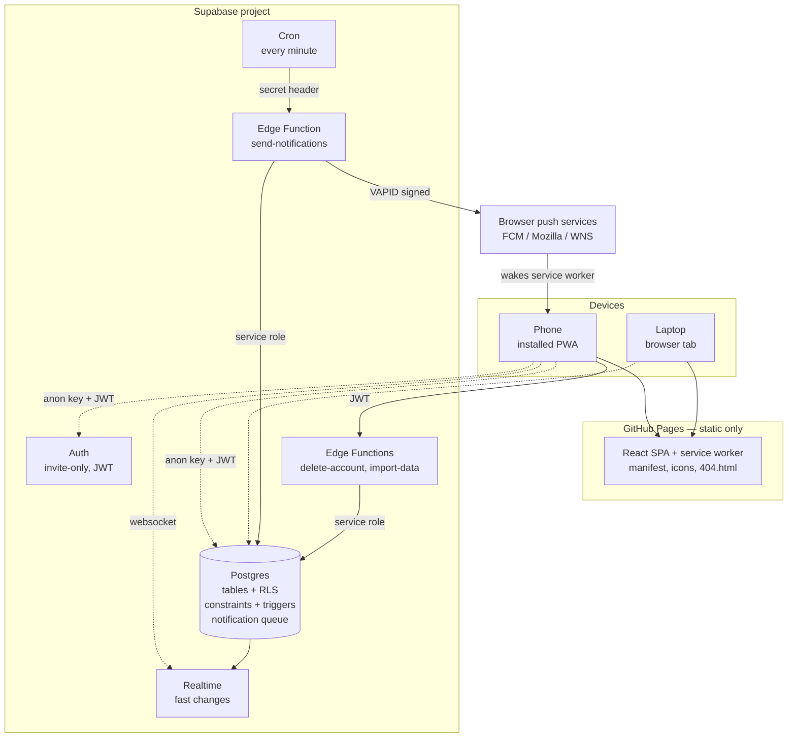

# Design Document

## Overview

This document designs Fastr as described in `requirements.md`: a multi-user intermittent fasting tracker, served as static
files from GitHub Pages, with Supabase as the entire back end.

The guiding principle is one sentence: **there is no application server, so the database is the application.** GitHub Pages
cannot run code, so every rule that would normally live in a Node handler has to live somewhere the browser cannot bypass.
That place is Postgres. Row Level Security decides who can see what, `CHECK` constraints and exclusion constraints decide
what a valid fast is, and triggers keep the notification queue in step with the fasts. Edge Functions exist only for the
three things the browser must not be trusted with: sending push notifications, deleting an account, and importing data.

Every decision below follows from that. Where a choice was close, the rejected option and the reason are recorded, because
"why not the other thing" is the more useful half of a design document.

### Decisions taken on the open questions

You approved the requirements without settling the three open questions, so these are the positions taken. All are cheap to
reverse now.

| Question | Decision | Reasoning |
| --- | --- | --- |
| Public or private repo | **Public.** | Pages on a private repo needs GitHub Pro. Nothing secret is committed: the anon key is public by design and protected by RLS, and every real secret lives in Supabase or GitHub Actions secrets. A public repo also makes the project something you can point at. |
| Supabase plan | **Free, plus a keep-alive workflow.** | $0 covers 500 MB and 50,000 monthly active users, which is far beyond a personal app. The one-week pause is the only real risk, and a scheduled GitHub Actions ping addresses it. The design keeps the paid upgrade to a single dashboard click by never depending on a free-plan-only behaviour. |
| Front-end Dockerfile | **Keep it.** | Twelve lines, and it is the answer to "can I run this somewhere other than Pages" without a redesign. It also gets built in CI, so it cannot rot unnoticed. |

### What this buys and what it costs

Worth stating plainly, because the trade is real.

**Gained:** $0 hosting, no server to patch or restart, no container to keep running for the app itself, automatic deploys,
and a working local stack from one command.

**Lost:** the ability to set HTTP headers, guaranteed always-on scheduling, and the comfort of validating input in one
place. The first is mitigated in Requirement 18.7, the second is the reason for the keep-alive and the stale-notification
rule, and the third is why validation is deliberately written twice, in Zod for the user's benefit and in Postgres for
correctness.

## Architecture

### Component diagram



The important line in that diagram is `cron --> efsend --> push`. It is the only path that runs without a user present, and
it is the entire reason Supabase is the back end rather than a static app with local storage.

### Component inventory and rationale

| Component | Role | Why this and not something else |
| --- | --- | --- |
| **GitHub Pages** | Serves the built SPA. | Free, already where the code lives, and one workflow deploys it. Netlify or Cloudflare Pages would add HTTP headers, which Pages cannot do, but also a second account and a second place to look when something breaks. Revisit if the meta-tag CSP proves too limiting. |
| **Supabase Auth** | Accounts, passwords, JWTs, password reset. | Writing authentication is the single worst use of time on a project like this. Invite-only is a dashboard setting rather than code. |
| **Postgres + RLS** | Data, and every rule that matters. | The browser talks to it directly, so it has to be the security boundary. RLS is the feature that makes a published anon key safe. |
| **Supabase Realtime** | Push fast changes to other open devices. | Requirement 5.6 needs a second device to notice. Realtime is already there and needs no extra service; polling on focus is the fallback and is implemented anyway for when the socket is down. |
| **Supabase Cron** | Fires the notification sender every minute. | `pg_cron` inside the same Postgres, so the schedule is a migration rather than a separate service. A GitHub Actions cron was the alternative and is limited to five minutes at best, often much worse under load. |
| **Edge Functions (Deno)** | Push sending, account deletion, import. | These need the service role key or the VAPID private key, neither of which can be in a browser. |
| **npm workspaces + Vite + React** | The Rally stack, minus the server. | Shared types between the app and the Edge Functions, one lint and test setup, one `npm run verify`. |
| **Supabase CLI** | Local Supabase in containers, migrations, function deploys. | Requirement 20. It is the only supported way to get the same Postgres, Auth and Realtime locally that production runs. |

### Rejected alternatives

**A Node server on Render, as originally specced.** Rejected because you asked for GitHub Pages. It was the easier design
in one respect only: validation and authorisation would live in one place instead of being split between Zod and Postgres.
It lost on cost, on the sleeping free instance breaking the headline notification feature, and on the free database being
deleted after 30 days.

**Static app with local storage only.** Genuinely simpler, genuinely free, and it fails three stated requirements: no
logins, no data on a second device, and no notification when the app is closed. Not viable.

**Firebase instead of Supabase.** Would work. Rejected on data model: fasting data is relational and the interesting
queries (streaks, overlap detection, stats over ranges) are SQL. Doing them in Firestore means either denormalising or
pulling everything into the client. Postgres also gives constraints, which are load-bearing here in a way Firestore's rules
cannot replicate.

**Validating only in Zod, trusting the client.** The tempting shortcut. Rejected outright: anyone can take the published
anon key and their own JWT and `POST` whatever they like straight to the REST endpoint. The browser is not a trust boundary.

## Data Models

### Where state lives

| State | Home | Why |
| --- | --- | --- |
| Account, email, password hash | Supabase `auth.users` | Managed by Auth. The app never touches it. |
| Profile, settings, default plan | `public.profiles`, one row per user | Settings need to follow the account to a new device, so they cannot be local-only. |
| Fasts, including mood and note | `public.fasts` | The core table. Everything else derives from it. |
| Weight, water, day notes | `public.weight_entries`, `water_entries`, `day_notes` | Separate tables because they have their own lifetimes and are not always tied to a fast. |
| Push subscriptions | `public.push_subscriptions` | Per device, not per user, so a user with three devices has three rows. |
| Pending notifications | `public.notifications` | Requirement 7.6 and 7.7: a queue in the database survives anything, where a timer in a browser survives nothing. |
| Reminders | `public.reminders` | A schedule, not an event. Rows are turned into `notifications` rows by cron. |
| Plan catalog, fasting stages | `packages/shared`, in code | Requirements 4.8 and 6.6. Adding a plan should be a pull request with a test, not a row someone edits at 1 a.m. |
| Theme, last known timer state | Device `localStorage`, as a cache | Requirement 14.2 needs the theme before first paint, and 15.3 needs a timer offline. Both are caches of the server's truth, never the truth. |

### Schema

Written as it will appear in `supabase/migrations`, lightly abbreviated. Types are `timestamptz` throughout; there is no
`timestamp without time zone` anywhere in this schema, which is deliberate and is the single most common source of
off-by-one-day bugs in an app that cares about calendar days.

```sql
create extension if not exists btree_gist;   -- for the overlap constraint below

create table public.profiles (
  id                  uuid primary key references auth.users(id) on delete cascade,
  display_name        text not null check (char_length(display_name) between 1 and 40),
  time_zone           text not null default 'UTC',
  weight_unit         text not null default 'kg'  check (weight_unit in ('kg','lb')),
  volume_unit         text not null default 'ml'  check (volume_unit in ('ml','floz')),
  theme               text not null default 'system' check (theme in ('light','dark','system')),
  default_plan_id     text not null default '16:8',
  custom_goal_minutes integer check (custom_goal_minutes between 60 and 4320),
  water_goal_ml       integer not null default 2000 check (water_goal_ml between 100 and 10000),
  notify_goal         boolean not null default true,
  notify_stages       boolean not null default false,
  notify_hour_before  boolean not null default false,
  health_notice_at    timestamptz,
  created_at          timestamptz not null default now(),
  updated_at          timestamptz not null default now()
);

create table public.fasts (
  id            uuid primary key default gen_random_uuid(),
  user_id       uuid not null references auth.users(id) on delete cascade,
  plan_id       text not null,
  goal_minutes  integer not null check (goal_minutes between 60 and 4320),   -- 1h to 72h, Req 17.3
  start_at      timestamptz not null,
  ended_at      timestamptz,
  status        text not null check (status in ('active','completed','ended_early')),
  mood          smallint check (mood between 1 and 5),
  energy        smallint check (energy between 1 and 5),
  note          text check (char_length(note) <= 1000),
  created_at    timestamptz not null default now(),
  updated_at    timestamptz not null default now(),

  -- An active fast has no end; a finished one must have one that is after its start.
  constraint fast_end_matches_status check (
    (status = 'active' and ended_at is null) or
    (status <> 'active' and ended_at is not null and ended_at > start_at)
  ),
  -- Req 5.3: a start may be backdated but never lies in the future. `now()` in a check is not
  -- immutable, so this is enforced by the trigger below rather than here.

  -- Req 5.9: no two fasts of one user may overlap in time. An active fast occupies
  -- [start_at, infinity), which is also what makes this enforce Req 5.2 for free.
  constraint fasts_no_overlap exclude using gist (
    user_id with =,
    tstzrange(start_at, coalesce(ended_at, 'infinity'::timestamptz), '[)') with &&
  )
);

-- Req 5.2, stated a second time and cheaply, because reading the exclusion constraint and
-- realising it implies "one active fast" takes a minute and this takes none.
create unique index fasts_one_active_per_user
  on public.fasts (user_id) where (status = 'active');

create index fasts_user_recent on public.fasts (user_id, start_at desc);
create index fasts_user_ended  on public.fasts (user_id, ended_at desc) where ended_at is not null;
```

The `fasts_no_overlap` exclusion constraint is the piece of this design doing the most work per line. It makes Requirement
5.2 (one active fast) and Requirement 5.9 (no overlaps) the same rule, enforced by Postgres, unbypassable from a browser
holding the anon key, and correct even when two devices race. Without it, both requirements would need a read-then-write in
the client, which is exactly the pattern that loses that race.

```sql
create table public.weight_entries (
  id          uuid primary key default gen_random_uuid(),
  user_id     uuid not null references auth.users(id) on delete cascade,
  measured_on date not null,
  grams       integer not null check (grams between 20000 and 400000),  -- Req 11.4
  created_at  timestamptz not null default now(),
  unique (user_id, measured_on)
);

create table public.water_entries (
  id       uuid primary key default gen_random_uuid(),
  user_id  uuid not null references auth.users(id) on delete cascade,
  logged_at timestamptz not null default now(),
  ml       integer not null check (ml between 1 and 5000)
);
create index water_user_day on public.water_entries (user_id, logged_at desc);

create table public.day_notes (
  id      uuid primary key default gen_random_uuid(),
  user_id uuid not null references auth.users(id) on delete cascade,
  day     date not null,
  mood    smallint check (mood between 1 and 5),
  energy  smallint check (energy between 1 and 5),
  note    text check (char_length(note) <= 1000),
  unique (user_id, day)
);

create table public.push_subscriptions (
  id           uuid primary key default gen_random_uuid(),
  user_id      uuid not null references auth.users(id) on delete cascade,
  endpoint     text not null unique,
  p256dh       text not null,
  auth         text not null,
  user_agent   text,
  created_at   timestamptz not null default now(),
  last_ok_at   timestamptz,
  failures     integer not null default 0
);

create table public.reminders (
  id         uuid primary key default gen_random_uuid(),
  user_id    uuid not null references auth.users(id) on delete cascade,
  local_time time not null,
  weekdays   smallint[] not null check (array_length(weekdays, 1) between 1 and 7),  -- 0=Sunday
  enabled    boolean not null default true
);

create table public.notifications (
  id        uuid primary key default gen_random_uuid(),
  user_id   uuid not null references auth.users(id) on delete cascade,
  fast_id   uuid references public.fasts(id) on delete cascade,
  kind      text not null check (kind in ('goal','stage','hour_before','reminder')),
  stage_key text,
  due_at    timestamptz not null,
  status    text not null default 'pending'
              check (status in ('pending','sent','skipped','cancelled')),
  claimed_at timestamptz,
  sent_at    timestamptz,
  attempts   integer not null default 0,
  created_at timestamptz not null default now()
);

-- The sender's only query: pending work, oldest first. Partial, so it stays small forever
-- regardless of how many sent rows accumulate.
create index notifications_due on public.notifications (due_at)
  where status = 'pending';

-- Req 7.7: the same logical notification must not exist twice, so a retried trigger or a
-- double cron run cannot produce two alerts.
create unique index notifications_unique_per_fast
  on public.notifications (fast_id, kind, coalesce(stage_key, ''))
  where fast_id is not null and status in ('pending','sent');
```

`fast_id` cascades on delete, so deleting a fast takes its pending notifications with it without any application code.
`claimed_at` is what makes Requirement 7.7's "safe if two runs overlap" true, and is explained under the sender below.

### Row Level Security

Requirement 18.1. Every table above follows the same shape, so it is written once here rather than nine times:

```sql
alter table public.fasts enable row level security;

create policy fasts_select on public.fasts
  for select using (user_id = auth.uid());
create policy fasts_insert on public.fasts
  for insert with check (user_id = auth.uid());
create policy fasts_update on public.fasts
  for update using (user_id = auth.uid()) with check (user_id = auth.uid());
create policy fasts_delete on public.fasts
  for delete using (user_id = auth.uid());
```

Four details that are easy to get wrong and are the reason Requirement 18.2's two-user test exists:

- **`for update` needs both `using` and `with check`.** With only `using`, a user can update their own row and set
  `user_id` to somebody else's, handing their row away. It is a strange attack and a trivial bug.
- **`profiles` gets no `insert` or `delete` policy at all.** Rows are created by a trigger on `auth.users` and removed by
  the cascade, so the client has no business doing either.
- **`notifications` gets only a `select` policy.** The client can see what is queued, which is useful in settings, and
  cannot write to it. Only the trigger and the Edge Function do, and both run with elevated rights.
- **RLS applies to the table owner's own queries only if forced.** The service role bypasses RLS by design, which is
  precisely why the service role key never leaves an Edge Function.

Requirement 18.3's CI check is a query, not a lint rule, which is why it can be trusted:

```sql
select tablename from pg_tables
 where schemaname = 'public'
   and not exists (
     select 1 from pg_class c join pg_namespace n on n.oid = c.relnamespace
      where n.nspname = 'public' and c.relname = tablename and c.relrowsecurity
   );
```

Any row returned fails the build. A new table without RLS is the single most likely way this app would leak data, and it is
also the easiest to catch, so it is caught mechanically rather than by remembering.

### Validation, written twice on purpose

Requirement 18.6. The same rule appears in two places, and this is not duplication to be refactored away:

- **Zod schemas in `packages/shared`** run in the browser. Their job is a good error message before a request is sent, and
  types the app compiles against.
- **Constraints in Postgres** run last. Their job is to be right when the request did not come from the app at all.

Where the two could drift, the Postgres constraint is the source of truth and the shared schema is tested against it: the
database test suite feeds each schema's boundary values (goal of 59 and 60 minutes, 4320 and 4321, weight of 19 kg and 20 kg)
straight to Postgres and asserts it accepts and rejects exactly what Zod does. A rule tightened in one place and forgotten
in the other fails that test.

## The notification pipeline

This is the part of Fastr that cannot be done by a static site, so it gets the most attention. It has four stages: a trigger
queues rows, cron wakes a function, the function claims and sends, and the service worker displays.

### 1. Queueing: a trigger, not the browser

Requirement 7.6 says the queue changes in the same transaction as the fast. That rules out the browser doing it, because a
phone that starts a fast and then loses signal would leave a fast with no notification queued, and nothing would ever
reconcile it.

```sql
create or replace function public.sync_fast_notifications()
returns trigger language plpgsql security definer set search_path = public as $$
declare
  s record;
  goal_at timestamptz;
begin
  -- Req 5.3, enforced here because now() cannot appear in a CHECK constraint.
  if new.start_at > now() + interval '1 minute' then
    raise exception 'start_at cannot be in the future';
  end if;
  if new.start_at < now() - interval '48 hours' and (tg_op = 'INSERT') then
    raise exception 'start_at cannot be more than 48 hours ago';
  end if;

  -- Anything still pending for this fast is now wrong. Cancel rather than delete, so the
  -- history of what was scheduled survives for debugging.
  update notifications set status = 'cancelled'
   where fast_id = new.id and status = 'pending';

  if new.status <> 'active' then
    return new;                        -- finished or cancelled: nothing more is due
  end if;

  goal_at := new.start_at + make_interval(mins => new.goal_minutes);

  insert into notifications (user_id, fast_id, kind, due_at)
  select new.user_id, new.id, 'goal', goal_at
   where exists (select 1 from profiles p where p.id = new.user_id and p.notify_goal)
     and goal_at > now()
  on conflict do nothing;

  insert into notifications (user_id, fast_id, kind, due_at)
  select new.user_id, new.id, 'hour_before', goal_at - interval '1 hour'
   where exists (select 1 from profiles p where p.id = new.user_id and p.notify_hour_before)
     and goal_at - interval '1 hour' > now()
  on conflict do nothing;

  -- Req 7.4. Only stages that fall inside this fast's goal are queued.
  for s in select key, at_minutes from fasting_stages
            where at_minutes > 0 and at_minutes <= new.goal_minutes
  loop
    insert into notifications (user_id, fast_id, kind, stage_key, due_at)
    select new.user_id, new.id, 'stage', s.key,
           new.start_at + make_interval(mins => s.at_minutes)
     where exists (select 1 from profiles p where p.id = new.user_id and p.notify_stages)
       and new.start_at + make_interval(mins => s.at_minutes) > now()
    on conflict do nothing;
  end loop;

  return new;
end $$;

create trigger fasts_sync_notifications
  after insert or update of start_at, goal_minutes, status on public.fasts
  for each row execute function public.sync_fast_notifications();
```

`on conflict do nothing` leans on the unique index from the schema section, so an edit that reschedules the same fast twice
cannot double-queue. The `> now()` guards mean editing a fast's start time backwards does not queue a pile of alerts that
are already overdue.

### The fasting_stages table, and Requirement 6.6

Requirement 6.6 puts the stage list in `packages/shared`, and the trigger above needs it in SQL. Two copies of the same list
is exactly the drift the requirement exists to prevent, so:

- `packages/shared/src/stages.ts` is the source of truth, and the web app imports it directly.
- `npm run gen:stages` reads it and writes `supabase/migrations/<timestamp>_fasting_stages.sql` as a `truncate` plus
  `insert`, which is idempotent and safe to re-run.
- CI runs the generator and fails if the working tree changes. A stage added in TypeScript and not regenerated is a red
  build, not a notification that never fires.

The same generator approach covers the plan catalog, though plans are not needed in SQL today. It is mentioned so the next
person does not solve it twice.

### 2. Waking up: Supabase Cron

```sql
select cron.schedule('fastr-send-notifications', '* * * * *', $$
  select net.http_post(
    url     := current_setting('app.settings.functions_url') || '/send-notifications',
    headers := jsonb_build_object(
                 'Content-Type', 'application/json',
                 'x-fastr-cron-secret', current_setting('app.settings.cron_secret')),
    timeout_milliseconds := 5000
  );
$$);
```

Every minute, per [Supabase's scheduling guide](https://supabase.com/docs/guides/functions/schedule-functions). One minute is
the finest granularity `pg_cron` offers and is the right resolution for this: nobody notices whether a sixteen-hour fast
reported in at 16:00:03 or 16:00:47, and the in-app alert (Requirement 7.10) covers the case where someone is watching the
timer to the second.

The URL and secret come from database settings rather than being hardcoded, so the same migration runs against local and
hosted projects. `x-fastr-cron-secret` is Requirement 18.5: the function does not verify a JWT because cron has no user, so
it verifies a shared secret instead and returns 401 otherwise.

### 3. Sending: the `send-notifications` Edge Function

The function runs with the service role key, so RLS does not apply to it. That is necessary, since it sends on behalf of
every user, and it is the reason the key never appears anywhere else.

Claiming is the part worth designing carefully. Requirement 7.7 says overlapping runs must not send twice, and a cron that
fires every minute against a function that occasionally takes longer than a minute will overlap.

```sql
-- One statement, run by the function. The row is claimed and returned atomically, so a second
-- concurrent run sees nothing to do rather than the same rows.
update notifications n
   set status = 'sent', claimed_at = now(), attempts = attempts + 1
 where n.id in (
   select id from notifications
    where status = 'pending' and due_at <= now()
    order by due_at
    limit 200
    for update skip locked
 )
returning n.*;
```

Two decisions in there:

- **`for update skip locked`** is what makes concurrent runs safe. The second run's `select` skips rows the first has
  locked instead of blocking on them, so it finishes quickly with nothing to do rather than queueing up behind.
- **The row is marked `sent` before the push is attempted, not after.** This chooses "possibly not delivered" over
  "possibly delivered twice". For a fasting alert, a missed notification is a minor annoyance and a duplicate at 3 a.m. is
  the kind of thing that gets an app deleted. `attempts` records the attempt so a genuinely broken push service is visible.

Then, per claimed row:

```
if due_at < now() - 30 minutes  ->  status = 'skipped', send nothing   (Req 7.8)
else compose from the shared stage/plan data, then for each push_subscription of that user:
     webpush.send(subscription, payload, vapid)
       404 or 410  -> delete the subscription row                      (Req 7.11)
       429 or 5xx  -> increment failures, leave the subscription alone
       success     -> last_ok_at = now(), failures = 0
```

The 30-minute rule is what makes a paused free project behave decently. A project restored after four days should not fire
a hundred alerts about fasts that ended on Tuesday. Skipped rows stay in the table, so "why did I not get a notification"
has an answer.

Web Push is sent with a small Deno-compatible library rather than a hand-rolled implementation, because the payload
encryption (ECDH plus HKDF plus AES-GCM) is unpleasant to get right and pointless to own.

### 4. Reminders

Requirement 8. A second cron job, hourly, turns reminder rows into notification rows:

```sql
insert into notifications (user_id, kind, due_at)
select r.user_id, 'reminder',
       -- the next occurrence of local_time in the user's own zone, as an instant
       ((now() at time zone p.time_zone)::date + r.local_time) at time zone p.time_zone
  from reminders r
  join profiles p on p.id = r.user_id
 where r.enabled
   and extract(dow from now() at time zone p.time_zone)::smallint = any (r.weekdays)
   and not exists (select 1 from fasts f                      -- Req 8.3
                    where f.user_id = r.user_id and f.status = 'active')
   and not exists (select 1 from notifications n               -- no duplicate for today
                    where n.user_id = r.user_id and n.kind = 'reminder'
                      and n.due_at::date = (now() at time zone p.time_zone)::date)
on conflict do nothing;
```

`at time zone` twice is the whole trick, and it is why `time_zone` is stored as an IANA name like `Africa/Nairobi` rather
than an offset. Converting to local, taking the date, adding the time, and converting back gives the correct instant across
daylight saving changes, which Requirement 8.4 asks for and a stored offset cannot deliver.

### 5. Displaying: the service worker

```js
self.addEventListener('push', (event) => {
  const data = event.data.json();
  event.waitUntil(
    self.registration.showNotification(data.title, {
      body: data.body,
      icon: '/fastr/icons/icon-192.png',
      badge: '/fastr/icons/badge.png',
      tag: data.tag,          // so a stage alert replaces the previous one
      data: { url: data.url },
    }),
  );
});

self.addEventListener('notificationclick', (event) => {
  event.notification.close();
  event.waitUntil(clients.openWindow(event.notification.data.url));
});
```

`tag` matters more than it looks: without it, a user who opted into stage notifications on a 24-hour fast collects six
separate banners. With it, each replaces the last.

### iPhone, stated honestly

Requirement 7.12. On iOS, `Notification.requestPermission` is unavailable in a Safari tab and only works once the PWA has
been added to the home screen, on iOS 16.4 or later. The app detects this rather than letting the button fail:

```ts
const isIos = /iPad|iPhone|iPod/.test(navigator.userAgent);
const isStandalone = window.matchMedia('(display-mode: standalone)').matches
  || (navigator as { standalone?: boolean }).standalone === true;

if (isIos && !isStandalone) {
  // Show the Share -> Add to Home Screen instructions instead of the permission button.
}
```

User-agent sniffing is normally the wrong tool, and this is the case where it is the only tool: there is no feature query
that distinguishes "push is unsupported here" from "push is unsupported until you install this".

## Timer correctness

Requirement 5.5 says the timer must be right after a reload, after the phone sleeps, and on a second device. Three rules
deliver that:

1. **The only stored value is `start_at`.** Elapsed time is always `now() - start_at`, recomputed, never accumulated. A
   counter incremented by `setInterval` drifts, and stops entirely when a phone sleeps or a background tab is throttled.
2. **Clock skew is measured once per session, not ignored.** A phone with a wrong clock would show a wrong elapsed time
   even with correct data. On load, the app reads the server time from the `Date` response header of its first Supabase
   request, stores the offset, and applies it. Skew beyond a couple of minutes is worth correcting; below that it is noise.
3. **The interval is for painting, not for counting.** A one-second `setInterval` re-renders from the clock. On
   `visibilitychange` back to visible, it recomputes immediately rather than waiting for the next tick, so a phone unlocked
   after four hours is correct on the first frame.

Requirement 19.2 interacts with this: a live region that updates every second is unusable with a screen reader. So the
visible timer is `aria-hidden`, and a separate polite live region announces only the things that matter, namely stage
changes and goal completion, with the full state available as text on demand.

## Components and Interfaces

### Repository layout

```
packages/shared      Domain types, Zod schemas, plan catalog, fasting stages, streak and stats
                     functions. Imported by the web app and by Edge Functions, so they cannot drift.
packages/web         The React SPA. The only deployed front end.
supabase/migrations  Every schema change, in order. The database is rebuildable from this alone.
supabase/functions   Edge Functions: send-notifications, delete-account, import-data.
supabase/tests       Database tests, including the two-user RLS suite.
supabase/seed.sql    Local-only seed: two test users and a little history.
scripts/             gen:stages, gen:vapid, and the migration/RLS checks CI runs.
.devcontainer/       Node, Supabase CLI, Docker-in-Docker.
```

Three packages became two. Rally's `packages/server` has no equivalent, and `packages/infra` is replaced by `supabase/`
plus two workflow files, because there is no cloud infrastructure to synthesise.

Edge Functions run on Deno and import from `packages/shared` by relative path. That works because the shared package is
plain TypeScript with no Node built-ins and no build step, exactly as Rally's is, and it is the reason Requirement 6.6's
single source of truth is achievable across two runtimes.

### The shared package

```ts
// Plan catalog (Req 4.8)
export interface FastingPlan {
  id: string;                    // '16:8'
  label: string;
  fastMinutes: number;
  eatMinutes: number;
  difficulty: 'beginner' | 'intermediate' | 'advanced';
  description: string;
  extended: boolean;             // 24h+, triggers the Req 17.2 notice
}

// Fasting stages (Req 6.1, 6.6)
export interface FastingStage {
  key: string;                   // 'fat_burning'
  atMinutes: number;             // 720
  name: string;
  description: string;           // hedged language, Req 6.5
}

export function stageAt(elapsedMinutes: number): FastingStage;
export function nextStage(elapsedMinutes: number): FastingStage | null;

// Streaks and stats (Req 10.6) — pure, no clock, no I/O
export function currentStreak(fasts: CompletedFast[], timeZone: string, today: Date): number;
export function longestStreak(fasts: CompletedFast[], timeZone: string): number;
export function stats(fasts: CompletedFast[], timeZone: string, now: Date): Stats;
```

`today` and `now` are parameters rather than `new Date()` inside. A streak function that reads the clock itself can only be
tested by faking the clock; one that takes it can be tested by passing a date, which is why Requirement 10.6's property
tests are straightforward to write.

### The streak algorithm, and the two things it gets wrong if rushed

Requirement 10.1 and 10.3. A fast counts toward the local calendar day it **ended** on.

```
1. Keep only fasts whose actual duration >= goal_minutes.          (met the goal)
2. Map each to a local day:  formatInTimeZone(ended_at, tz, 'yyyy-MM-dd')
3. Reduce to a set of distinct day strings.
4. Walk back from today. If today is absent, start from yesterday instead.
   Count consecutive days present in the set, stopping at the first gap.
```

Step 2 must use a real time-zone conversion, not `ended_at.getDate()`. A fast ending at 01:00 in Nairobi is 22:00 the
previous day in UTC, so the naive version silently credits the wrong day and breaks a streak that should have continued.

Step 4's "today or yesterday" is the difference between a streak that feels fair and one that feels punitive. Without it, a
user who has not yet finished today's fast sees their streak read zero from midnight until they end it, which is wrong in a
way that makes the number untrustworthy.

Two properties worth asserting with `fast-check`, both of which found real bugs in equivalent code:

- The streak is invariant under the order of the input array.
- A day on which a fast ends during a daylight saving transition is counted exactly once, never zero or two times.

### Web app structure

```
src/
  main.tsx              Mounts the app. Registers the service worker.
  routes/
    Timer.tsx           Home. Ring, stage, start/stop, water quick-add.
    Plans.tsx           The catalog (Req 4). First screen after first sign-in.
    History.tsx         List plus calendar (Req 9).
    Stats.tsx           Streaks, averages, weight chart (Req 10, 11).
    Settings.tsx        Profile, theme, notifications, export, delete (Req 3, 14, 16).
    SignIn.tsx          Sign in, password reset, invite acceptance (Req 1, 2).
  components/           Ring, StageList, FastCard, Calendar, WeightChart, MoodPicker.
  data/
    supabase.ts         The single client. Created once.
    fasts.ts            Queries and mutations for fasts.
    profile.ts          ...and so on, one module per table.
    realtime.ts         Subscription to the user's own fast changes (Req 5.6).
  time/                 Clock offset, formatting, time-zone helpers.
  theme/                Token definitions, light and dark (Req 14).
  pwa/                  Manifest, service worker registration, install and offline prompts.
  test/setup.ts         jsdom setup, matchers, axe.
```

Data access is one module per table rather than one hook per screen, because several screens need the same query and a
per-screen hook guarantees two copies of it that diverge.

### Realtime, and the fallback that does the real work

Requirement 5.6:

```ts
supabase.channel(`fasts:${userId}`)
  .on('postgres_changes',
      { event: '*', schema: 'public', table: 'fasts', filter: `user_id=eq.${userId}` },
      () => queryClient.invalidateQueries({ queryKey: ['fasts'] }))
  .subscribe();
```

The subscription invalidates rather than applying the payload. Trusting the payload means writing the same state-merging
logic twice, once for fetches and once for events, and they will disagree.

It is also not the primary mechanism. A phone that has been in a pocket for six hours has no live socket, and the moment
that matters is when the user opens the app. So a refetch on `visibilitychange` and on reconnect is implemented first and
tested first, and Realtime is the improvement layered on top for the case where two devices are awake at once.

## GitHub Pages: three problems and their fixes

### Deep links (Requirement 15.6)

Pages has no server-side routing, so `/fastr/history` returns a 404 before the app loads. The standard fix for a project
site is to make the 404 the app: the build copies `index.html` to `404.html`, Pages serves it for any unmatched path, and
the router reads the URL from there. Ugly in that the response status is 404, invisible to users, and it costs nothing.

`vite.config.ts` sets `base: '/fastr/'`, and the router gets a matching `basename`. Both, or assets 404 in one configuration
and routes break in the other.

### Security headers (Requirement 18.7)

Pages sets no headers, so the Content Security Policy goes in a `<meta>` tag:

```html
<meta http-equiv="Content-Security-Policy" content="
  default-src 'self';
  connect-src 'self' https://<project-ref>.supabase.co wss://<project-ref>.supabase.co;
  img-src 'self' data:;
  style-src 'self' 'unsafe-inline';
  script-src 'self';
  base-uri 'none';
  form-action 'none';
  object-src 'none'">
```

What a meta tag cannot do, stated because pretending otherwise is worse than the gap:

- **`frame-ancestors` is ignored in a meta tag.** So is `X-Frame-Options`, which is a header only. Fastr can be framed by
  another site. The mitigation is that it holds no sensitive action behind a single click, and the app calls this out in the
  README rather than claiming protection it does not have.
- **`Strict-Transport-Security` is a header only.** `github.io` is on the HSTS preload list, so browsers already enforce
  HTTPS for it. This is luck rather than design, and it is worth knowing it is load-bearing if a custom domain is ever added.
- **`style-src 'unsafe-inline'`** is present because React writes inline styles for the progress ring's rotation. It could
  be removed by moving to CSS custom properties, which is a worthwhile follow-up and not a launch blocker.

### The service worker and stale app shells

A cached app shell that never updates is the classic PWA failure: a user runs last month's JavaScript against this month's
database. So the worker uses network-first for the app shell and cache-first only for hashed assets and icons, takes over
immediately on activation, and the app shows a small "a new version is ready, reload" prompt rather than reloading under
someone's fingers mid-fast.

Supabase requests are never cached. Requirement 15.4's offline behaviour comes from the last successful query result plus
the cached `start_at`, which is enough to keep the timer running, with mutations disabled and clearly marked as unavailable
rather than queued and silently lost.

## The other two Edge Functions

### `delete-account` (Requirement 3.3)

Deleting an auth user needs the service role, so it cannot happen in the browser. The function verifies the caller's JWT,
takes the user ID **from the verified token and never from the request body**, and calls
`auth.admin.deleteUser(id)`. Every `public` table references `auth.users(id) on delete cascade`, so one call removes
everything, including push subscriptions and queued notifications.

Taking the ID from the token rather than the body is the difference between a delete-my-account endpoint and a
delete-anyone's-account endpoint.

### `import-data` (Requirement 16.3)

Import runs server-side because it must be all-or-nothing: a half-imported history with overlapping fasts is worse than a
failed import. The function validates the whole payload against the shared Zod schemas, refuses to run if the account
already has any fasts ("into an empty account", per the requirement), and inserts inside a transaction so the overlap
constraint rejecting one row rolls back all of them.

Export needs no function at all. The client already has permission to read exactly its own rows, so it queries each table
and assembles the JSON and CSV in the browser. Requirement 16.2's exclusions come for free: there is no policy letting the
client read auth data, and push subscriptions are simply left out of the export query.

## Theme

Requirement 14.2 asks for no flash of the wrong theme, which means the theme must be applied before React runs. So a tiny
inline script in `index.html` reads `localStorage` and sets `data-theme` on `<html>` before first paint, and React later
reconciles it with the value from the profile.

Colours are CSS custom properties per theme, not a JavaScript theme object, so the switch is one attribute change rather
than a re-render. Requirement 14.3's contrast is checked arithmetically in a test against the token pairs, the same approach
Rally took and for the same reason: `axe` derives contrast from rendered pixels, jsdom does not paint, so its contrast rules
are disabled and the criterion most easily broken by a design tweak would otherwise be the one nothing verifies.

## Testing strategy

| Layer | Tool | What it covers |
| --- | --- | --- |
| Pure domain logic | Vitest, node | Plans, stages, streaks, stats, unit conversion, formatting. |
| Properties | fast-check | Streak invariants across time zones and DST (Req 10.6). |
| Schemas against the database | Vitest against local Supabase | Boundary values accepted and rejected identically by Zod and Postgres. |
| Constraints | Vitest against local Supabase | Overlapping fasts rejected, two active fasts impossible, goal over 72h rejected, weight out of range rejected. |
| RLS | Vitest against local Supabase | Two real users; each of select, insert, update, delete attempted across the boundary on every table (Req 18.2). |
| Triggers | Vitest against local Supabase | Queue contents after start, edit, end, cancel, delete. Stage notifications only within the goal. |
| Sender | Vitest, with the push library and Postgres faked at the boundary | Claiming, the 30-minute skip, 410 deleting a subscription, concurrent runs sending once. |
| Components and screens | Vitest, jsdom, Testing Library | Every screen, including empty, loading, error and offline states. |
| Accessibility | axe-core | Automated checks on every screen (Req 19.5). |
| Contrast | Arithmetic test | Token pairs against WCAG 2.1 AA. |

The database tests run against a real local Supabase rather than a mock, for the same reason Rally runs real Redis and
DynamoDB: a mocked exclusion constraint always passes, and the exclusion constraint is where two of this design's
requirements actually live. Following Rally's CI stance, these tests **skip locally with a warning** when Supabase is not
running, and **fail in CI**, because a green run that silently skipped every RLS test is worse than no run.

What the suite does not cover, for the README:

- Whether a real push notification arrives on a real phone. The sender is tested; browser push services are not testable in
  CI. This needs a person with a phone, once per browser.
- iOS install-then-permission flow. Simulators do not reproduce it faithfully.
- VoiceOver and TalkBack on an actual phone.
- Contrast on a real screen with the axe browser extension against the running app.

## Local development

Requirement 20. One command has to be enough.

```bash
npm install          # includes the pinned Supabase CLI, no global install
npm run setup        # supabase start, apply migrations, seed, write packages/web/.env.local
npm run dev          # Vite on :5173 against local Supabase on :54321
```

`npm run setup` writes the local URL and anon key into `packages/web/.env.local` by parsing `supabase status -o env`, so
nobody copies a key by hand. The local stack includes Postgres, Auth, Realtime, Edge Functions, Studio, and Inbucket for
email, which means invite links and password resets are testable offline.

Two honest limitations:

- **`pg_cron` in the local stack does not reliably fire the scheduled job**, so the sender is invoked directly during
  development with `npm run send:notifications`, and its scheduling is verified against the hosted project. This is stated
  here so it is not discovered as a bug.
- **Podman is best-effort.** The Supabase CLI targets Docker. Setting `DOCKER_HOST` to the Podman socket works for some
  people and not others, so Docker is the documented path and Podman is documented as untested, rather than promised.

Seed users (local only, Requirement 20.7): `a@fastr.test` and `b@fastr.test`, both with password `fastr-local-dev`. Two
rather than one, because the RLS tests need a second user to fail against.

## CI and deployment

Two workflows, split by blast radius.

### `ci.yml` — every push and pull request

```
checkout
setup-node 22, npm cache
npm ci
supabase start                          (fails the run if it does not come up, Req 22.3)
supabase db reset                       (every migration, from scratch, on every run)
npm run gen:stages && git diff --exit-code    (Req 6.6: no drift)
node scripts/check-rls.mjs              (Req 18.3: fails if any public table lacks RLS)
npm run typecheck
npm run lint
npm run format:check
npm test                                (unit + database + RLS + components)
npm run build --workspace @fastr/web
docker build .                          (Req 22.4: the Dockerfile cannot rot)
```

`supabase db reset` on every run is the check that matters most in the long term: it proves the migration history still
builds a working database from nothing, which is the property that quietly breaks and is only discovered when it is needed.

### `deploy-pages.yml` — push to `main`, after CI passes

Builds with `VITE_SUPABASE_URL` and `VITE_SUPABASE_ANON_KEY` from repository **variables**, not secrets. They are public by
design (Requirement 21.3), and putting them in secrets would only hide them from the person maintaining the project while
shipping them in the bundle anyway. Publishes with `actions/deploy-pages`, `permissions: pages: write, id-token: write`, and
nothing else.

### `deploy-supabase.yml` — manual only

`workflow_dispatch`, in a protected `production` environment, holding the one long-lived secret in the project
(`SUPABASE_ACCESS_TOKEN`). It runs `supabase db push` and `supabase functions deploy`. Manual because a migration is not
reversible by re-running the previous workflow, and because a schema change landing automatically at the same moment as the
front end that depends on it is a race worth not having.

### `keep-alive.yml`

Every three days, a single unauthenticated request to the Supabase REST endpoint, to keep the project from pausing after a
week of inactivity. Its own limitation, stated in the README: GitHub disables scheduled workflows in a repository with no
commits for 60 days, so this keeps the project alive only while the repo is alive. It is a mitigation, not a guarantee, and
the guarantee costs $25 a month.

## Cost and limits

| Item | Plan | Monthly |
| --- | --- | --- |
| GitHub Pages, public repo | Free | $0 |
| GitHub Actions, public repo | Free | $0 |
| Supabase: Postgres, Auth, Realtime, Edge Functions, Cron | Free | $0 |
| **Total** | | **$0** |

What the free plan costs in reliability, and where it stops being acceptable:

| Limit | Effect on Fastr | Response |
| --- | --- | --- |
| Project pauses after one week of inactivity | While paused, the app cannot sign in and sends no notifications | `keep-alive.yml`; the 30-minute skip stops a flood on restore; export exists so data is never trapped |
| 500 MB database | Not a constraint. A decade of fasts for a handful of users is single-digit megabytes | None needed |
| 50,000 monthly active users | Not a constraint | None needed |
| Built-in email is rate-limited | Invites and password resets are limited to a few per hour | Fine for invite-only. Attach a real SMTP provider if it ever matters |
| Pages needs a public repo on a free GitHub plan | The code is public | Nothing secret is committed; the anon key is public by design and RLS is the boundary |

Upgrading to Supabase Pro at $25 a month removes the pause and is a dashboard click. Nothing in this design depends on a
free-plan behaviour, so that upgrade changes no code.

## Error handling

| Failure | Behaviour |
| --- | --- |
| Offline | A banner, cached timer keeps running, mutations disabled with a reason (Req 15.4) |
| Supabase unreachable or project paused | A clear "cannot reach Fastr's server" message distinct from "you are offline", with a retry |
| JWT expired | Silent refresh; on failure, back to sign-in with the current route preserved |
| Constraint violation on write | Mapped to a human sentence: overlap becomes "that overlaps a fast you already logged", not a Postgres error code |
| Push permission denied | The control reflects it and explains how to re-enable it in browser settings, rather than asking again |
| Sender fails for one subscription | Logged, that subscription's `failures` incremented, other subscriptions still sent |

Requirement 18.9 constrains all of the above: no log line may contain a token, a push key, or the text of a note. Errors are
logged with an identifier and a category, not with the payload that caused them.

## Open risks

Three things this design does not fully resolve, recorded rather than hidden.

1. **Whether cron traffic counts as activity for the one-week pause is unconfirmed.** If it does, `keep-alive.yml` is
   redundant. If it does not, the keep-alive is what matters. Both are cheap, so both are in.
2. **Notification timing depends on a free-tier scheduler.** The design bounds the damage (a one-minute resolution, a
   30-minute staleness cut-off, an in-app alert as a second path) but cannot promise a notification lands within a minute of
   the goal on a free project.
3. **Fastr can be framed,** because `frame-ancestors` cannot be set from a meta tag on GitHub Pages. Moving the front end to
   a host that sets headers fixes it, and is a change of workflow rather than of application code.
