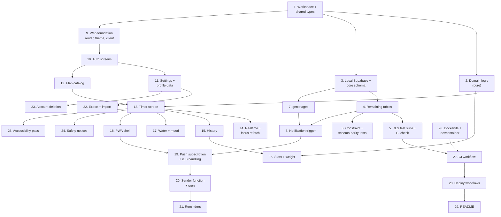

# Implementation Plan

## Overview

Sequenced so each task builds on working code from the one before it, with nothing left orphaned. Four ordering decisions
worth stating, because they are deliberate rather than arbitrary.

**Pure logic comes before anything with I/O.** Stages, streaks, stats and unit conversion are the rules most worth getting
exhaustively right, and the design keeps them free of I/O so they can be tested without a database or a browser. They land
second, right after the workspace.

**The database comes before the UI.** In this architecture the database *is* the application: RLS is the security boundary
and constraints are the business rules. Building screens first would mean writing validation in the client and then
discovering which half of it Postgres already handles. So the schema, its constraints, and the tests that prove a second
user cannot reach the first user's rows all land before the first screen.

**RLS is tested the moment there is a table to test.** Task 5 exists early, and on its own, because a leak here is the worst
thing that can happen to this app and the cost of finding it late is a rewrite of every policy. After task 5, every new
table arrives with its policies and its two-user test in the same task.

**Notifications come late, and in two halves.** Queueing (a database trigger, task 8) is separable from sending (an Edge
Function and cron, task 20) and is far easier to test. Queueing lands early so the rows are correct long before anything
tries to deliver them.

**Two non-coding prerequisites**, neither of which blocks anything before the task that needs it:

- Before task 3: a container runtime. **Resolved: Podman, not Docker.** Docker Desktop is blocked by policy on this
  machine; Podman 6 works once `[analytics]` is off in `config.toml`, and `npm run setup` handles the rest. See "Podman, and
  why it is not a footnote" in the design.
- Before task 20: create the hosted Supabase project, turn off public sign-up, and enable the `pg_cron` and `pg_net`
  extensions. Task 20 is the first that cannot be fully verified locally, since `pg_cron` does not fire reliably in the
  local stack.

## Task dependency graph



Execution waves. Every task in a wave can proceed in parallel once the previous wave is complete:

```json
{
  "waves": [
    {
      "wave": 1,
      "tasks": ["1"],
      "description": "Workspace and the shared package. Everything imports from here, so it lands alone."
    },
    {
      "wave": 2,
      "tasks": ["2", "3", "26"],
      "description": "Pure domain logic, the local Supabase stack with the core schema, and the container definitions. All independent."
    },
    {
      "wave": 3,
      "tasks": ["4", "7", "9"],
      "description": "The remaining tables, the stage generator, and the web app foundation. The web foundation needs only the shared package."
    },
    {
      "wave": 4,
      "tasks": ["5", "6", "8", "10"],
      "description": "The RLS suite and constraint tests, the notification trigger, and the auth screens. Wave 4 is the first point at which the security boundary is proven."
    },
    {
      "wave": 5,
      "tasks": ["11", "12"],
      "description": "Settings and profile data access, and the plan catalog."
    },
    {
      "wave": 6,
      "tasks": ["13", "22", "23"],
      "description": "The timer screen, plus export, import and account deletion, which need only settings. Completing task 13 is the first usable milestone: you can start and end a real fast."
    },
    {
      "wave": 7,
      "tasks": ["14", "15", "17", "18", "24"],
      "description": "Realtime, history, water and mood, the PWA shell, and the safety notices."
    },
    {
      "wave": 8,
      "tasks": ["16", "19", "25"],
      "description": "Stats and weight, push subscriptions, and the accessibility pass."
    },
    {
      "wave": 9,
      "tasks": ["20"],
      "description": "The sender Edge Function and cron. The second milestone: a notification arrives on a phone with the app closed."
    },
    {
      "wave": 10,
      "tasks": ["21", "27"],
      "description": "Reminders, and the CI workflow now that every test layer exists."
    },
    {
      "wave": 11,
      "tasks": ["28"],
      "description": "Deploy workflows for Pages, Supabase, and keep-alive."
    },
    {
      "wave": 12,
      "tasks": ["29"],
      "description": "The README, written last so it documents what was actually built."
    }
  ]
}
```

## Tasks

- [x] 1. Set up the workspace and the shared package
  - Create an npm workspace with `packages/shared` and `packages/web`, TypeScript 5 in strict mode with `noUncheckedIndexedAccess` and `exactOptionalPropertyTypes`, ESM throughout, matching Rally's `tsconfig.base.json`
  - Configure ESLint 9 flat config and Prettier at the root, including the `no-restricted-syntax` rule banning `dangerouslySetInnerHTML`, `innerHTML` and `outerHTML`
  - Add a root `vitest.config.ts` with a project per package: node for `shared`, jsdom for `web`
  - Add root scripts: `build`, `typecheck`, `lint`, `format`, `format:check`, `test`, `verify`
  - Define the domain types in `packages/shared`: `FastingPlan`, `FastingStage`, `Fast`, `Profile`, `WeightEntry`, `WaterEntry`, `DayNote`, `Reminder`, and the notification kinds
  - Write the plan catalog as data: 12:12, 14:10, 16:8, 18:6, 20:4, OMAD, 24-hour, 36-hour, Custom, each with fasting and eating minutes, difficulty, description, and an `extended` flag for 24h and over
  - Write the fasting stage list as data: the eight stages from the design with their minute offsets, names, and hedged descriptions
  - Write Zod schemas for every write the app performs, exported alongside the types
  - Add `.gitignore` (matching Rally's, plus `supabase/.branches` and `supabase/.temp`) and `.env.example` with placeholders only
  - _Requirements: 4.1, 4.2, 4.3, 4.8, 6.1, 6.5, 6.6, 18.6, 18.8_

- [x] 2. Implement the domain logic as pure functions
  - Implement `stageAt` and `nextStage` over the shared stage list, plus the minutes-until-next-stage calculation
  - Implement `currentStreak` and `longestStreak` taking the fasts, an IANA time zone, and the current date as parameters, never reading the clock internally
  - Map each fast to a local calendar day using a real time-zone conversion on `ended_at`, count only fasts whose duration met their goal, and start the walk from today or yesterday
  - Implement `stats`: total completed, average length over the last 7 and 30 days, longest fast, goal completion rate
  - Implement unit conversion: grams to kg and lb, ml to fl oz, with formatting helpers
  - Write unit tests for each, including the zero-fast and single-fast cases
  - Write `fast-check` property tests asserting the streak is invariant under input order, and that a fast ending during a daylight saving transition is counted exactly once
  - _Requirements: 6.1, 6.2, 10.1, 10.2, 10.3, 10.4, 10.6, 11.2_

- [x] 3. Stand up local Supabase and the core schema
  - Add the Supabase CLI as a pinned dev dependency and run `supabase init`
  - Write the first migration: the `btree_gist` extension, `profiles`, and `fasts` exactly as specified in the design, including the `goal_minutes` range check capping a fast at 72 hours, the status and end-time consistency check, the `fasts_no_overlap` exclusion constraint, the partial unique index enforcing one active fast, and the two read indexes
  - Add a trigger on `auth.users` that creates a `profiles` row on sign-up, with the display name taken from the invite metadata
  - Add an `updated_at` trigger for both tables
  - Enable RLS on both tables with select, insert, update and delete policies scoped to `auth.uid()`, giving `update` both `using` and `with check`, and giving `profiles` no insert or delete policy
  - Write `supabase/seed.sql` creating two local test users with known passwords and a little fasting history
  - Add `npm run setup`: start Supabase, apply migrations, seed, and write the local URL and anon key into `packages/web/.env.local` by parsing `supabase status -o env`
  - _Requirements: 1.6, 5.2, 5.9, 5.11, 17.3, 18.1, 20.1, 20.2, 20.3, 20.7_

- [x] 4. Add the remaining tables
  - Migrate `weight_entries` with the 20 kg to 400 kg range check and a unique constraint per user per day
  - Migrate `water_entries` and `day_notes`, with the note length check and the mood and energy range checks
  - Migrate `push_subscriptions` with a unique endpoint, and `reminders` with the weekday array check
  - Migrate `notifications` with the kind and status checks, the partial index on pending rows by due time, and the unique index preventing the same logical notification existing twice
  - Enable RLS on all of them with the same policy shape, except `notifications`, which gets a select policy only
  - _Requirements: 7.6, 8.1, 11.1, 11.4, 12.1, 13.1, 18.1_

- [x] 5. Prove the security boundary
  - Add a test helper that signs in as each of the two seed users and returns a client per user
  - For every table, write tests asserting that user B cannot select, insert on behalf of, update, or delete user A's rows, and that each attempt fails or returns nothing rather than partially succeeding
  - Add a test asserting a user cannot update their own row to set `user_id` to another user, which is the hole left by a policy with `using` but no `with check`
  - Write `scripts/check-rls.mjs` querying `pg_tables` and `pg_class` for any table in `public` without `relrowsecurity`, exiting non-zero and naming the tables
  - Make the database tests skip with a warning when local Supabase is not running, and add an environment flag that turns a skip into a failure, for CI
  - _Requirements: 18.1, 18.2, 18.3_

- [x] 6. Prove the constraints and the schema parity
  - Write tests asserting Postgres rejects: two active fasts for one user, a fast overlapping an existing one, an end before its start, a goal of 4321 minutes, a weight of 19 kg and of 401 kg, a note over 1,000 characters, and a mood of 0 or 6
  - Write tests asserting Postgres accepts the values immediately inside each of those boundaries
  - Write a parity test that feeds each Zod schema's boundary values to Postgres and asserts both accept and reject exactly the same set, so a rule tightened in one place and forgotten in the other fails
  - _Requirements: 5.2, 5.9, 11.4, 13.1, 17.3, 18.6_

- [x] 7. Generate the fasting_stages table from the shared list
  - Add a `fasting_stages` table with a key, minute offset, name and description
  - Write `scripts/gen-stages.mjs`, which reads the stage list from `packages/shared` and writes an idempotent migration containing a `truncate` and an `insert`
  - Add `npm run gen:stages`, run it, and commit the generated migration
  - Add a test asserting the table contents match the shared list exactly, so the CI drift check has something to fail on
  - _Requirements: 6.1, 6.6_

- [x] 8. Queue notifications from a database trigger
  - Write `sync_fast_notifications` as a `security definer` function: reject a start time in the future or more than 48 hours in the past on insert, cancel every pending notification for the fast, and return early when the fast is no longer active
  - Queue the goal notification, the one-hour-before notification, and one notification per stage falling within the fast's goal, each conditional on the matching profile preference and on the due time still being in the future, using `on conflict do nothing`
  - Attach the trigger to insert and to updates of `start_at`, `goal_minutes` and `status`
  - Write tests covering: starting a fast queues the right rows, editing the start time reschedules them, ending or cancelling a fast cancels them, deleting a fast removes them by cascade, stage rows beyond the goal are never queued, and a user with notifications switched off gets none
  - _Requirements: 5.3, 7.4, 7.5, 7.6_

- [x] 9. Build the web app foundation
  - Create `packages/web` with Vite, React 18, TypeScript and `base: '/fastr/'`, and a build step that copies `index.html` to `404.html` so deep links load on GitHub Pages
  - Add the router with a matching `basename`, and the route shells for Timer, Plans, History, Stats, Settings and SignIn
  - Create the single Supabase client module reading `VITE_SUPABASE_URL` and `VITE_SUPABASE_ANON_KEY`, failing loudly at startup if either is missing
  - Add the Content Security Policy meta tag from the design, with the Supabase origin injected at build time
  - Implement the theme system: CSS custom properties for light and dark, the pre-paint inline script in `index.html` reading `localStorage`, and a System option following `prefers-color-scheme`
  - Build the responsive layout shell: a bottom tab bar under 768 px, side navigation above it, 44 px minimum touch targets, usable from 320 px
  - Add the offline and error banner components, and a query client with sensible retry and stale-time defaults
  - Add `src/test/setup.ts` with Testing Library, jest-dom and axe
  - _Requirements: 14.1, 14.2, 15.1, 15.5, 15.6, 18.7_

- [x] 10. Build the auth screens
  - Build the sign-in screen with a single generic error message for any credential failure
  - Build invite acceptance: set a display name and password from the invite link, then sign in
  - Build the password reset request and completion screens
  - Build the health notice gate: shown before the account is usable, recording `health_notice_at` on acknowledgement
  - Capture the browser time zone on first sign-in and store it on the profile
  - Implement the session layer: automatic refresh, a route guard preserving the intended route across a sign-in, and sign-out that revokes the session server-side
  - Write tests for the error message being identical for an unknown email and a wrong password, the guard redirecting and restoring, and the health gate blocking the app until acknowledged
  - _Requirements: 1.2, 1.3, 1.5, 1.6, 2.1, 2.2, 2.4, 2.5, 2.8, 17.1_

- [x] 11. Build the profile data layer and the settings screen
  - Write the `profile` data module: read and update, one place for every settings write
  - Build the settings screen: display name, time zone, units, theme, water goal, and the notification preference toggles
  - Implement the password change flow, handling the re-authentication requirement when the session is too old
  - Implement sign out of all other devices, and sign out of other sessions on password change
  - Show the health notice again from settings
  - Write tests for each update path and for the optimistic theme change persisting to the profile
  - _Requirements: 2.6, 2.7, 3.1, 3.2, 14.1, 14.2, 17.1_

- [x] 12. Build the plan catalog
  - Build the catalog screen from the shared plan list: fasting and eating hours, difficulty, and description per plan, laid out as cards
  - Mark plans of 24 hours or more as extended and show the extended-fast notice on them
  - Implement selecting a plan, which saves it as the default without touching a fast in progress
  - Build the Custom plan control: 1 to 72 hours in 15-minute steps, stored as `custom_goal_minutes`
  - Route a user with no plan chosen to this screen after first sign-in
  - Write tests for selection persisting, the custom range rejecting 0 and 73 hours, and the extended notice appearing on exactly the plans of 24 hours and over
  - _Requirements: 4.1, 4.2, 4.3, 4.4, 4.5, 4.6, 4.7_

- [x] 13. Build the timer screen
  - Write the `fasts` data module: the active fast, start, end, cancel, and edit
  - Measure the clock offset once per session from the `Date` header of the first Supabase response, and apply it everywhere elapsed time is computed
  - Build the timer: elapsed, remaining, goal end time in the user's zone, and a progress ring recomputed from `start_at` on a one-second interval, plus an immediate recompute on `visibilitychange`
  - Continue counting past the goal, showing time over
  - Build start with an optional backdated start time, limited to 48 hours back and never in the future
  - Build end with a confirmation, recording `completed` or `ended_early`, and cancel, which discards the fast
  - Build the current stage, the next stage, time until it, stage markers on the ring, and a tappable stage description linking to the health notice
  - Map constraint violations to human sentences, with the overlap case reading as a clash with an existing fast rather than a Postgres error
  - Write tests for a timer that is correct after a remount, correct with a clock offset applied, and correct when the goal has passed
  - _Requirements: 5.1, 5.2, 5.3, 5.4, 5.5, 5.7, 5.8, 5.9, 5.10, 5.11, 6.2, 6.3, 6.4_

- [x] 14. Keep devices in step
  - Subscribe to `postgres_changes` on `fasts` filtered to the signed-in user, invalidating queries rather than applying payloads
  - Refetch on `visibilitychange` to visible and on network reconnect, implemented and tested as the primary path rather than as a fallback
  - Show a subtle indicator when the realtime channel is down, without implying the app is broken
  - Write tests for a remote insert causing a refetch, and for a focus event refetching with the channel closed
  - _Requirements: 5.6_

- [x] 15. Build history
  - Build the list: finished fasts newest first, with date, plan, duration, goal, whether the goal was met, and the recorded mood and energy
  - Add keyset pagination
  - Build the calendar view marking each day with a completed fast
  - Build editing a past fast's start and end, its mood, energy and note, and deleting it, surfacing the overlap constraint as a readable message
  - Build adding a past fast manually
  - Write tests for pagination, for the calendar marking the local day a fast ended on, and for an edit that would overlap being rejected
  - _Requirements: 9.1, 9.2, 9.3, 9.4, 9.5, 13.4_

- [x] 16. Build stats and the weight log
  - Build the stats screen from the shared functions: current streak, longest streak, total completed, 7 and 30 day averages, longest fast, and goal completion rate, always derived and never stored
  - Write the `weight` data module and build logging, editing and deleting an entry in the user's chosen unit, stored as grams
  - Build the weight chart over 30 days, 90 days, 1 year and all time, with a data table alternative for screen readers and no meaning conveyed by colour alone
  - Write tests for the stats matching the pure functions on the same data, and for the chart's table alternative being present and correct
  - _Requirements: 10.1, 10.2, 10.4, 10.5, 11.1, 11.2, 11.3, 11.5, 19.3_

- [x] 17. Build water and mood logging
  - Build the water quick-add buttons and a custom amount on the timer screen, with today's total against the user's goal, undo of the last entry, and editing or deleting any day's entries, where today means the user's local calendar day
  - Build the mood and energy pickers and the note field, attachable to a fast or to a day
  - Add the optional, skippable "How did it go?" prompt when ending a fast
  - Render every note as plain text
  - Write tests for the local-day boundary, for undo, and for a note containing markup rendering as text
  - _Requirements: 12.1, 12.2, 12.3, 12.4, 13.1, 13.2, 13.3_

- [x] 18. Build the PWA shell
  - Add the manifest, the icon set, and the service worker registration
  - Implement network-first caching for the app shell and cache-first for hashed assets and icons, never caching Supabase requests
  - Implement the update flow: take over on activation and prompt for a reload rather than reloading during a fast
  - Implement offline behaviour: a banner, the timer continuing from the cached start time, and mutations disabled with a stated reason rather than queued
  - Add the install prompt, and the iPhone add-to-home-screen instructions
  - Write tests for the offline state disabling mutations and keeping the timer running
  - _Requirements: 15.2, 15.3, 15.4_

- [x] 19. Build push subscription
  - Write `scripts/gen-vapid.mjs` generating a VAPID key pair and printing where each half belongs
  - Build the "Turn on notifications" control, requesting permission only on that tap and never on load, then storing the subscription
  - Detect iPhone in a Safari tab and show the add-to-home-screen instructions in place of the permission button
  - Reflect a denied permission accurately, explaining how to re-enable it rather than asking again
  - Implement the service worker `push` and `notificationclick` handlers, using a tag so stage alerts replace one another
  - Build the in-app alert for a goal reached while the app is open, with an optional sound
  - Build the "Send test notification" button in settings
  - Write tests for permission being requested only on the tap, for the iOS branch, and for the denied state
  - _Requirements: 7.1, 7.2, 7.9, 7.10, 7.12, 7.13, 15.2_

- [x] 20. Build the notification sender and schedule it
  - Write the `send-notifications` Edge Function: reject any request without the correct cron secret, then claim due rows with a single `update ... where id in (select ... for update skip locked)` statement, marking them sent before attempting delivery
  - Mark anything more than 30 minutes overdue as skipped instead of sending it
  - Compose each message from the shared plan and stage data, imported from `packages/shared`
  - Send with a Deno Web Push library using the VAPID keys from function secrets, deleting a subscription on 404 or 410 and incrementing its failure count on 429 or 5xx
  - Add the migration scheduling the function every minute through `pg_cron` and `pg_net`, reading the functions URL and cron secret from database settings
  - Add `npm run send:notifications` for local invocation, since `pg_cron` does not fire reliably in the local stack
  - Write tests for the secret being required, the claim being safe under concurrency, the staleness cut-off, and the 410 path deleting a subscription
  - Verify end to end against the hosted project: a fast whose goal passes while the app is closed produces a notification on a phone
  - _Requirements: 7.3, 7.4, 7.5, 7.7, 7.8, 7.11, 18.4, 18.5_

- [x] 21. Build reminders
  - Build the reminder settings: a local time, the weekdays it applies to, and an enable toggle
  - Add the hourly cron job inserting reminder notifications, converting the local time through the profile's time zone, skipping users with an active fast, and skipping a day already queued
  - Write tests for the time-zone conversion across a daylight saving change, and for an active fast suppressing the reminder
  - _Requirements: 8.1, 8.2, 8.3, 8.4_

- [ ] 22. Build export and import
  - Build the JSON export in the browser from the user's own rows, covering fasts, notes, weight, water, reminders, plan and settings, and excluding auth data and push subscriptions
  - Build the CSV export of fasts
  - Write the `import-data` Edge Function: verify the JWT, validate the whole payload against the shared schemas, refuse to run if the account already has fasts, and insert inside a transaction so a constraint violation rolls everything back
  - Build the import control in settings, with a clear statement that it only works on an empty account
  - Write tests for a round trip through export and import producing identical data, and for a payload with overlapping fasts importing nothing at all
  - _Requirements: 16.1, 16.2, 16.3_

- [ ] 23. Build account deletion
  - Write the `delete-account` Edge Function: verify the JWT, take the user ID from the verified token and never from the body, and call `auth.admin.deleteUser`
  - Build the settings flow requiring the user to type a confirmation phrase, then signing them out
  - Write a test asserting the function ignores a user ID in the request body, and a database test asserting every user-owned row is gone after the auth user is deleted
  - _Requirements: 3.3, 3.4, 18.4_

- [ ] 24. Add the safety notices
  - Show the extended-fast notice and require confirmation when selecting or starting a fast of 24 hours or more
  - Show a prominent prompt suggesting the user end an active fast once it passes 72 hours
  - Link stage descriptions to the health notice
  - Write tests for the confirmation being required at exactly 24 hours and not below it, and for the 72-hour prompt appearing
  - _Requirements: 6.5, 17.2, 17.3, 17.4_

- [ ] 25. Accessibility pass
  - Make the visible ticking timer `aria-hidden` and add a polite live region announcing only stage changes and goal completion, with the full state available as text
  - Walk every screen by keyboard, fixing focus order and adding a visible focus indicator throughout
  - Ensure the ring, the calendar and the charts convey nothing by colour alone
  - Respect `prefers-reduced-motion` across the ring animation and every transition
  - Add automated `axe` checks to every screen, in each of its empty, loading, error and offline states
  - Add the arithmetic contrast test over the light and dark token pairs against WCAG 2.1 AA, with `axe`'s own contrast rules disabled since jsdom does not paint
  - _Requirements: 19.1, 19.2, 19.3, 19.4, 19.5_

- [ ] 26. Add the container definitions
  - Write a multi-stage `Dockerfile` building the web app and serving it with a small static server as a non-root user
  - Write `.dockerignore` excluding `node_modules`, `.git`, `.env` files and build output
  - Write `.devcontainer/devcontainer.json` with Node 22, the Supabase CLI and Docker-in-Docker, so the project opens ready to run in Kiro, VS Code or Codespaces
  - Confirm `npm run setup` works inside the dev container
  - _Requirements: 20.4, 20.5, 20.6_

- [ ] 27. Build the CI workflow
  - Run on push and pull request, with a concurrency group cancelling superseded runs and `permissions: contents: read`
  - Install with `npm ci`, start local Supabase in the runner, and fail the run if it does not come up
  - Run `supabase db reset` so every migration is applied from scratch on every run
  - Run `npm run gen:stages` and fail if the working tree changed
  - Run `scripts/check-rls.mjs`, typecheck, lint, format check, and the full test suite with database tests set to fail rather than skip
  - Build the web app and build the `Dockerfile`
  - _Requirements: 6.6, 18.3, 22.1, 22.2, 22.3, 22.4, 22.5_

- [ ] 28. Build the deployment workflows
  - Write `deploy-pages.yml`: on push to `main` after CI passes, build with the Supabase URL and anon key from repository variables, and publish with `actions/deploy-pages` using only `pages: write` and `id-token: write`
  - Write `deploy-supabase.yml`: manual only, in a protected `production` environment, running `supabase db push` and `supabase functions deploy` with the access token from a secret
  - Write `keep-alive.yml`: every three days, one lightweight request to the Supabase REST endpoint
  - Verify the deployed app end to end on a phone and a laptop: sign in, start a fast, and see it on the other device
  - _Requirements: 21.1, 21.2, 21.3, 21.4, 22.5_

- [ ] 29. Write the README
  - Follow Rally's structure: what Fastr is, running it locally, environment variables, layout, working on it, deployment, cost and limits, accessibility and what the tests do not cover, and where the design lives
  - Give copy-paste commands for first-time setup, development, tests, inviting a user, generating VAPID keys, and both deploys
  - Document every environment variable and secret with where it lives, its default and its purpose, in a table
  - Document the one-time hosted setup: creating the project, disabling public sign-up, enabling `pg_cron` and `pg_net`, setting function secrets, setting the repository variables and the access token secret, and enabling Pages
  - Document the free-plan limits and their effects: the one-week pause, 500 MB, rate-limited email, and Pages needing a public repo, along with what Supabase Pro costs and that upgrading needs no code change
  - Document the keep-alive workflow and its own limit, that GitHub disables scheduled workflows in a repository with no commits for 60 days
  - Document what the test suite cannot cover: real push delivery on a real phone, the iOS install-then-permission flow, VoiceOver and TalkBack, and contrast on a real screen
  - Document the two known gaps: that a meta-tag CSP cannot set `frame-ancestors`, and that `pg_cron` does not fire reliably in the local stack
  - Write it in short, plain sentences
  - _Requirements: 1.7, 2.3, 3.4, 19.5, 20.6, 20.8, 21.5, 21.6, 21.7, 23.1, 23.2, 23.3, 23.4_
